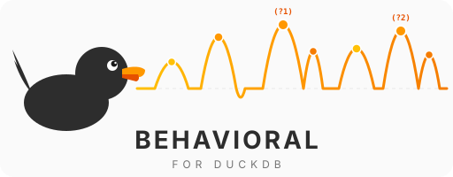

<p align="center">
  
</p>

<p align="center">
  <strong>Behavioral analytics functions for DuckDB, inspired by ClickHouse.</strong>
</p>

<p align="center">
  <a href="https://github.com/tomtom215/duckdb-behavioral/actions/workflows/ci.yml"></a>
  <a href="LICENSE"></a>
  <a href="https://www.rust-lang.org"></a>
  <a href="https://tomtom215.github.io/duckdb-behavioral/"></a>
</p>

<p align="center">
  <a href="#quick-start">Quick Start</a> &bull;
  <a href="#functions">Functions</a> &bull;
  <a href="#examples">Examples</a> &bull;
  <a href="#known-limitations">Limitations</a> &bull;
  <a href="#performance">Performance</a> &bull;
  <a href="https://tomtom215.github.io/duckdb-behavioral/">Documentation</a>
</p>

---

Funnels, retention, sessions and "what happens next" over an event table, as
SQL aggregate and window functions in a loadable [DuckDB](https://duckdb.org/)
extension written in Rust. Six of the eight functions follow ClickHouse's
[parametric behavioral functions](https://clickhouse.com/docs/en/sql-reference/aggregate-functions/parametric-functions)
and were compared with `clickhouse local` on random event groups; the
[few deliberate differences](#clickhouse-parity) are listed. `sessionize` and
`window_funnel_events` are additions.

## Quick start

```sql
INSTALL behavioral FROM community;
LOAD behavioral;
```

How far did each user get through view → cart → buy, with 1 hour to finish?

```sql
CREATE TABLE events AS SELECT * FROM (VALUES
  (1, TIMESTAMP '2024-01-01 10:00', 'view'), (1, TIMESTAMP '2024-01-01 10:05', 'cart'),
  (1, TIMESTAMP '2024-01-01 10:20', 'buy'),  (2, TIMESTAMP '2024-01-01 11:00', 'view'),
  (2, TIMESTAMP '2024-01-01 11:10', 'cart'), (3, TIMESTAMP '2024-01-01 12:00', 'view'),
  (3, TIMESTAMP '2024-01-01 15:00', 'cart')
) AS t(user_id, event_time, event_type);

SELECT user_id,
       window_funnel(INTERVAL '1 hour', event_time,
                     event_type = 'view', event_type = 'cart', event_type = 'buy') AS furthest_step
FROM events GROUP BY user_id ORDER BY user_id;
```

```
┌─────────┬───────────────┐
│ user_id │ furthest_step │
│  int32  │     int32     │
├─────────┼───────────────┤
│       1 │             3 │
│       2 │             2 │
│       3 │             1 │
└─────────┴───────────────┘
```

User 3 stops at step 1 because the cart came 3 hours after the view.

The functions sort by timestamp themselves: no `ORDER BY` is needed inside
the call, and `GROUP BY` is the normal way to use all but `sessionize`.

> **Personal Project Disclaimer**: This is a personal project developed on my own
> time. It is not affiliated with, endorsed by, or related to my employer or
> professional role in any way.

> **AI-Assisted Development**: Built with Claude (Anthropic). Correctness is
> validated by automated testing — not assumed from AI output. See [Quality](#quality).

### Installing

| | |
|---|---|
| **Community channel** (`INSTALL behavioral FROM community`) | DuckDB 1.4.4 and later; Linux x86_64 and ARM64, macOS x86_64 and ARM64, Windows x86_64 |
| **Build from source or a release archive** | DuckDB 1.3.2 and later; Linux and macOS |

One binary serves every DuckDB release: it uses only DuckDB's stable C API
(stamped `C_STRUCT`, C API v1.2.0), and CI loads the same build into DuckDB 1.3.2,
1.4.4, 1.5.0, 1.5.6 and 2.0.0 and asserts the results. To build from source:

```bash
git submodule update --init --recursive
make configure release
duckdb -unsigned -c "LOAD 'build/release/behavioral.duckdb_extension'; SELECT behavioral_version();"
```

DuckDB loads only `.duckdb_extension` files that carry its metadata footer, which
`make` appends; a plain `cargo build --release` library is refused. Needs Rust 1.88+,
a C compiler and Python 3.

## Functions

| Function | Signature | Returns | Description |
|---|---|---|---|
| `sessionize` | `(TIMESTAMP, INTERVAL)` | `BIGINT` | Window function: session IDs from inactivity gaps |
| `retention` | `(BOOLEAN, BOOLEAN, ...)` | `BOOLEAN[]` | Cohort retention: was condition *i* met, given condition 1? |
| `window_funnel` | `(INTERVAL [, VARCHAR], TIMESTAMP, BOOLEAN, ...)` | `INTEGER` | Furthest funnel step reached, with [6 combinable modes](https://tomtom215.github.io/duckdb-behavioral/functions/window-funnel.html) |
| `window_funnel_events` | `(INTERVAL [, VARCHAR], TIMESTAMP, BOOLEAN, ...)` | `TIMESTAMP[]` | Timestamps of the best funnel chain |
| `sequence_match` | `(VARCHAR, TIMESTAMP, BOOLEAN, ...)` | `BOOLEAN` | Did an [event pattern](https://tomtom215.github.io/duckdb-behavioral/functions/sequence-match.html) occur? |
| `sequence_count` | `(VARCHAR, TIMESTAMP, BOOLEAN, ...)` | `BIGINT` | How many non-overlapping times? |
| `sequence_match_events` | `(VARCHAR, TIMESTAMP, BOOLEAN, ...)` | `TIMESTAMP[]` | When did each pattern step happen? |
| `sequence_next_node` | `(VARCHAR, VARCHAR, TIMESTAMP, VARCHAR, BOOLEAN, ...)` | `VARCHAR` | The value of the event right after (or before) a pattern |

Every `TIMESTAMP` argument also accepts `TIMESTAMPTZ`. `behavioral_version()`
returns the loaded version. `window_funnel` and `window_funnel_events` take 1 to
32 conditions, `retention` and the `sequence_*` pattern functions 2 to 32, and
`sequence_next_node` a base condition plus 1 to 32 event conditions (DuckDB's
own error for a 33rd lists every overload; the limit is 32).

What to expect from all of them:

- **Errors, not silent wrong answers.** Unknown modes, malformed patterns,
  out-of-range condition numbers, month-based or negative intervals, and
  configuration that differs between rows of one group raise descriptive SQL
  errors. A `NULL` timestamp skips the row; a `NULL` condition counts as false.
- **Deterministic under parallelism.** Events sort by total keys, so thread
  count and row order do not change a result. Property tests check every
  aggregate for order, split and combine-tree invariance (`src/oracle_tests.rs`),
  and CI runs a `GROUP BY` at 1 and 4 threads and requires identical rows.
  ClickHouse's own results depend on row order in two cases; see
  [ClickHouse parity](#clickhouse-parity).
- **Exact at the edges.** Gaps touching DuckDB's `±infinity` timestamps are
  computed exactly instead of wrapping.

Reference pages, with edge cases per function:
[Function Reference](https://tomtom215.github.io/duckdb-behavioral/functions/sessionize.html).

## Examples

The examples below use `events(user_id, event_time, event_type, page)`. The
[SQL Cookbook](https://tomtom215.github.io/duckdb-behavioral/cookbook.html) and
[Use Cases](https://tomtom215.github.io/duckdb-behavioral/use-cases.html) have
many more, and [`examples/`](examples/) holds runnable scripts.

**Sessions** — a new session after 30 minutes of silence:

```sql
SELECT user_id, event_time,
       sessionize(event_time, INTERVAL '30 minutes') OVER (
         PARTITION BY user_id ORDER BY event_time) AS session_id
FROM events;
```

**Funnel drop-off** — how many users stop at each step:

```sql
WITH funnels AS (
  SELECT user_id,
         window_funnel(INTERVAL '1 hour', event_time,
           event_type = 'page_view', event_type = 'add_to_cart',
           event_type = 'checkout',  event_type = 'purchase') AS step
  FROM events GROUP BY user_id)
SELECT step AS reached_step, count(*) AS users,
       round(100.0 * count(*) / sum(count(*)) OVER (), 1) AS pct
FROM funnels GROUP BY step ORDER BY step;
```

**Weekly retention** — signup cohorts that came back in weeks 1 and 2:

```sql
SELECT cohort_week, count(*) AS cohort_size,
       count(*) FILTER (WHERE r[2]) AS week_1, count(*) FILTER (WHERE r[3]) AS week_2
FROM (SELECT user_id, cohort_week,
             retention(
               activity_date >= cohort_week AND activity_date < cohort_week + INTERVAL 7 DAY,
               activity_date >= cohort_week + INTERVAL 7 DAY AND activity_date < cohort_week + INTERVAL 14 DAY,
               activity_date >= cohort_week + INTERVAL 14 DAY AND activity_date < cohort_week + INTERVAL 21 DAY) AS r
      FROM activity GROUP BY user_id, cohort_week)
GROUP BY cohort_week ORDER BY cohort_week;
```

**Pattern with a time limit** — a view followed by a purchase within an hour
(thresholds in `(?t…)` are seconds):

```sql
SELECT user_id,
       sequence_match('(?1).*(?t<=3600)(?2)', event_time,
         event_type = 'page_view', event_type = 'purchase') AS converted_within_hour
FROM events GROUP BY user_id;
```

**What comes next** — the page after Home → Product, per user, then counted
(group by user first, or all users' events form one sequence):

```sql
SELECT next_page, count(*) AS users
FROM (SELECT sequence_next_node('forward', 'first_match', event_time, page,
               page = 'Home', page = 'Home', page = 'Product') AS next_page
      FROM events GROUP BY user_id)
GROUP BY next_page ORDER BY users DESC;
```

Pattern syntax: `(?N)` an event satisfying condition *N*; `.` exactly one
event; `.*` any number; `(?t>=S)`, `(?t<=S)`, `(?t>S)`, `(?t<S)`, `(?t==S)` a
time constraint of *S* seconds between the neighbouring steps. Events that
satisfy none of the passed conditions are dropped before matching.

From Python, Node.js, dbt, or files:

```python
import duckdb
con = duckdb.connect()
con.execute("INSTALL behavioral FROM community"); con.execute("LOAD behavioral")
con.sql("SELECT user_id, window_funnel(INTERVAL '1 hour', event_time, event_type = 'view', "
        "event_type = 'purchase') FROM read_parquet('events/*.parquet') GROUP BY user_id").show()
```

```javascript
import { DuckDBInstance } from '@duckdb/node-api';   // the maintained Node client (`duckdb` is legacy)
const connection = await (await DuckDBInstance.create(':memory:')).connect();
await connection.run('INSTALL behavioral FROM community');
await connection.run('LOAD behavioral');
```

```yaml
# dbt-duckdb profiles.yml
extensions:
  - name: behavioral
    repo: community
```

## Known limitations

- **Crashes in DuckDB's C API aggregate path on older releases.** Some query
  shapes make DuckDB read out of bounds for *every* C API aggregate, not just
  this extension ([duckdb/duckdb#26109](https://github.com/duckdb/duckdb/issues/26109)):
  `ORDER BY` inside the call, `OVER ()`, a frame written `BETWEEN UNBOUNDED
  PRECEDING AND UNBOUNDED FOLLOWING`, and, on 1.3.2 and 1.4.4, `OVER (PARTITION
  BY g)` with no `ORDER BY`. Which releases crash was tested per shape:

  | Query shape | 1.3.2 | 1.4.4 | 1.5.0 | 1.5.6 | 2.0.0 |
  |---|---|---|---|---|---|
  | `f(.. ORDER BY ts)`, `OVER ()`, `UNBOUNDED..UNBOUNDED` | crash | crash | crash | crash | works |
  | `OVER (PARTITION BY g)` or `OVER (PARTITION BY 1)` (no `ORDER BY`) | **crash** | **crash** | works | works | works |
  | `OVER (PARTITION BY g ORDER BY ts)` with any bounded frame | works | works | works | works | works |

  Run for `window_funnel` on every release shown (`scripts/crash-shapes.sh`
  prints this table); the first two rows were also run for the other seven
  functions on 1.3.2 and 2.0.0. None of these shapes is needed: the functions
  sort by timestamp themselves, so on DuckDB older
  than 2.0 use `GROUP BY` (and a join to put the result back on each row) or a
  bounded frame. Details: [FAQ](https://tomtom215.github.io/duckdb-behavioral/faq.html#which-query-shapes-crash-duckdb).
- **`GROUP BY … LIMIT n` without `ORDER BY` leaks memory.** When DuckDB stops a
  grouped scan early (`LIMIT`, an interrupt) it never destroys the aggregate
  states it did not reach, so each unreached group's collected events stay
  allocated until the process exits. Measured: ~77 MB lost per query for
  300,000 groups of 10 events (`window_funnel_events`, `sequence_count`), 136 MB
  for `sequence_next_node`. Put `ORDER BY` before `LIMIT`, or materialise the
  aggregate first; a long-lived process that runs such queries repeatedly will
  grow. This is DuckDB's behaviour for every aggregate that owns heap memory.
- **`sessionize` needs an ordered window.** Use `OVER (… ORDER BY ts)` with an
  ascending order: a descending order opens a session on every row, and as a
  plain `GROUP BY` aggregate the result depends on scan order and thread count.
- **Running window frames are quadratic.** In `OVER (ORDER BY ts)` every row is a
  separate aggregate over all earlier rows, and DuckDB holds about 2,048 such
  frames at once: one 40,000-row partition took 11–12 s and 1.2 GB for
  `window_funnel` (DuckDB 1.5.6 and 2.0.0, one thread). Partition by user, bound
  the frame (`ROWS 1000 PRECEDING`), or use `GROUP BY`. `sessionize` is the
  exception; its state is constant-size.
- **No cancellation within one group.** DuckDB's C API gives an aggregate no way
  to observe an interrupt, so Ctrl-C takes effect once the group being finalized
  is done: 0.8–1.3 s for 10 million events and a 3- to 5-step `sequence_*`
  pattern, longer for very long patterns (capped at 1,024 steps).
- **Memory outside `memory_limit`.** Collected events (16 bytes each; 24 plus the
  value bytes for `sequence_next_node`) live on the Rust heap, which DuckDB does
  not account for or spill. An allocation that fails raises an `out of memory`
  error instead of crashing.

## Performance

Measured on a shared 4-vCPU Intel Xeon @ 2.80 GHz, Linux, Rust 1.97.0, DuckDB
2.0.0, release build.

**In SQL.** [`scripts/bench-sql.sh`](scripts/bench-sql.sh) builds 10 million
rows in 100,000 groups of 100 events and runs each query in a fresh `duckdb`
process with 4 threads (wall time in seconds, median [min-max] of 9 runs;
includes DuckDB's scan and grouping):

| Query | Time |
|---|---|
| `window_funnel`, 3 steps | 1.58 [1.49-1.63] |
| `window_funnel_events` | 1.60 [1.49-1.67] |
| `sequence_count('(?1).*(?2).*(?3)')` | 1.75 [1.63-1.81] |
| `sequence_match_events('(?1).*(?2)')` | 1.61 [1.54-1.66] |
| `sequence_next_node` | 3.33 [3.13-3.68] |
| `retention`, 3 conditions | 0.46 [0.43-0.52] |
| `sessionize` over `PARTITION BY u ORDER BY ts` | 1.92 [1.81-2.05] |
| `window_funnel` over one 10-million-row group | 0.56 [0.54-0.64] |

**The aggregates alone.** Criterion benchmarks of the Rust state functions,
without DuckDB (95% confidence interval of the mean):

| Function | Elements | Time | Throughput |
|---|---|---|---|
| `sessionize` update | 1 billion | 1.68 s [1.66-1.70] | 595 Melem/s |
| `retention` combine | 100 million | 251 ms [246-256] | 398 Melem/s |
| `window_funnel` finalize, 8 conditions | 100 million | 2.12 s [1.93-2.27] | 47 Melem/s |
| `sequence_match` | 100 million | 1.49 s [1.26-1.70] | 67 Melem/s |
| `sequence_count` | 100 million | 1.50 s [1.28-1.72] | 67 Melem/s |
| `sequence_match_events` | 100 million | 1.30 s [1.18-1.52] | 77 Melem/s |

The 100-million rows come from 10 samples each on a shared machine, hence the
wide intervals. [`PERF.md`](PERF.md) has the full tables, the method, and the
same-machine comparison with v0.10.1 (Session 21): no change within the spread
of repeated runs, except `sequence_next_node`, which takes about half the time
(6.85 s to 3.33 s above). Reproduce with `cargo bench` and
`scripts/bench-sql.sh <duckdb> <extension>`.

## ClickHouse parity

All six ClickHouse behavioral functions are implemented. Each was compared with
`clickhouse local` 26.10.2.103 (`window_funnel` also on 26.9.8.3, with identical
results) on random event groups: ties, events matching several conditions,
every mode combination, random patterns. Counts and the remaining differences
are in
[ClickHouse Compatibility](https://tomtom215.github.io/duckdb-behavioral/internals/clickhouse-compatibility.html).

| Function | Result |
|---|---|
| `retention` | Identical in 200,000 groups |
| `window_funnel` | Identical for 15 of the 24 mode combinations in every variant; the 6 that use `strict_increase` without `strict_once` differ by design, and the 3 that pair `strict_deduplication` with `strict_once` differ only when ties arrive in a different order than the extension's sort |
| `sequence_match`, `sequence_count` | Identical when time constraints follow `(?N)` or `.` and the pattern does not end in `.*` or a vacuous constraint (where ClickHouse reads past its action list); differ by design after `.*` |
| `sequence_match_events` | As above, except that where ClickHouse can report an abandoned attempt the extension reports the events that matched (5,174 of 600,000 results with distinct timestamps) |
| `sequence_next_node` | Identical with distinct (timestamp, value) per event; with ties, identical whenever ClickHouse receives rows in the extension's tie order |

Deliberate differences, each because ClickHouse is defective or depends on row order:

- `window_funnel` with `strict_increase` (without `strict_once`): ClickHouse keeps
  one chain per level and loses a valid one (`c1@0, c1@1, c2@1` gives 1; the
  extension gives 2).
- `window_funnel` with `strict_deduplication` + `strict_once`, and
  `sequence_next_node` with rows tying on timestamp and value: ClickHouse's answer
  changes with row order; the extension orders ties deterministically.
- `sequence_*` time constraints after `.*` are measured from the last matched
  event; ClickHouse measures from the event after it. A constraint before any
  `(?N)` or `.` is an error here.

Also: NULL conditions count as false (ClickHouse skips the row), timestamps are
microseconds with `(?t)` thresholds in seconds, windows are `INTERVAL`s, and
`retention` over zero rows returns `[]`. The complete list is in
[ClickHouse Compatibility](https://tomtom215.github.io/duckdb-behavioral/internals/clickhouse-compatibility.html).

## Quality

| | |
|---|---|
| Unit tests | 540, plus 1 doc-test, including 37 property tests (proptest). The `window_funnel` engine is compared with an exhaustive reference and every state with order- and combine-tree-invariance checks (`src/oracle_tests.rs`) |
| Integration tests | 29, in process: the release library is loaded into a real DuckDB and every function runs through SQL, including error paths, `±infinity` timestamps, and parallel determinism |
| End-to-end | `make test_release` (8 SQL logic files in `test/sql/`) and 21 asserted queries (`scripts/compat-check.sh`) on Linux and macOS, then the same build in DuckDB 1.3.2, 1.4.4, 1.5.0 and 1.5.6 |
| Differential | Against ClickHouse, see above |
| Mutation testing | cargo-mutants: 93.9% of viable mutants detected across the 9 non-FFI modules (0.10.0 audit, before the test changes in this release) |
| Lints | Clippy pedantic + nursery + cargo groups with `-D warnings`; `unsafe_code` denied outside `src/ffi`, every `unsafe` block one operation with a `// SAFETY:` note (lint-enforced) |
| CI | Format, clippy, tests on 2 OSes, docs, MSRV 1.88, WASM compile check, benchmarks compile, `cargo deny`, workflow and shell lint, coverage; weekly toolchain, dependency and DuckDB-nightly canaries |
| Releases | 4 platforms, SHA-256 checksums and build-provenance attestations |

## Building and contributing

```bash
DUCKDB_DOWNLOAD_LIB=1 cargo test    # tests link a prebuilt libduckdb, no C++ build
./scripts/check.sh                  # everything CI runs that works offline
make configure release test_release # the extension, as the community CI builds it
```

[`CONTRIBUTING.md`](CONTRIBUTING.md) has the workflow, [`RELEASING.md`](RELEASING.md)
the release steps, [`PERF.md`](PERF.md) the benchmark protocol and history, and
[`CHANGELOG.md`](CHANGELOG.md) the release notes. This project follows
[Semantic Versioning](https://semver.org/); the
[versioning policy](https://tomtom215.github.io/duckdb-behavioral/operations/security.html#versioning)
applies it to SQL signatures.

## Documentation

[Getting Started](https://tomtom215.github.io/duckdb-behavioral/getting-started.html) ·
[Function Reference](https://tomtom215.github.io/duckdb-behavioral/functions/sessionize.html) ·
[Use Cases](https://tomtom215.github.io/duckdb-behavioral/use-cases.html) ·
[SQL Cookbook](https://tomtom215.github.io/duckdb-behavioral/cookbook.html) ·
[Quick Reference](https://tomtom215.github.io/duckdb-behavioral/quick-reference.html) ·
[Engineering Overview](https://tomtom215.github.io/duckdb-behavioral/engineering.html) ·
[Performance](https://tomtom215.github.io/duckdb-behavioral/internals/performance.html) ·
[ClickHouse Compatibility](https://tomtom215.github.io/duckdb-behavioral/internals/clickhouse-compatibility.html)

## License

MIT
