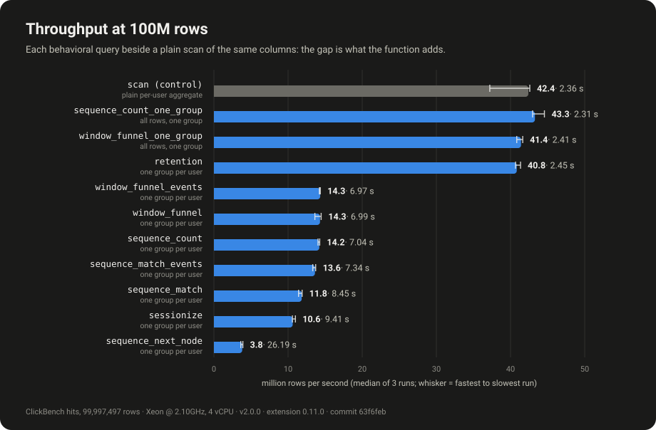
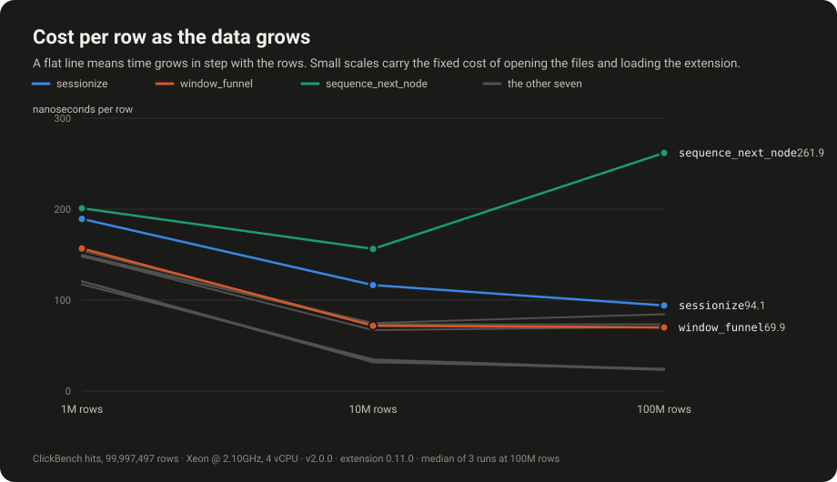
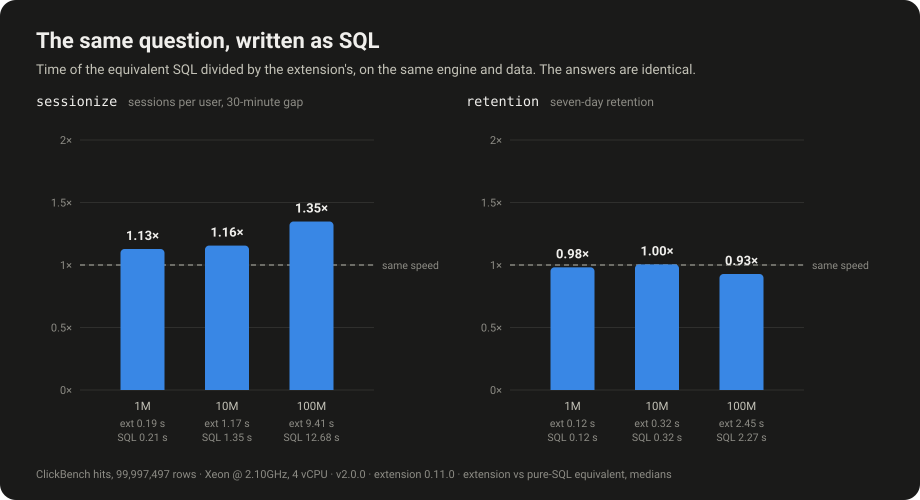

# Benchmark on the ClickBench `hits` data

The [Criterion benchmarks](./performance.md) time the Rust state functions on
synthetic input, and `scripts/bench-sql.sh` times SQL on a synthetic table. This
page is the third kind: the eight functions run as SQL, inside DuckDB, over real
data that anyone can download, with a harness that checks its own answers.

There is no standard benchmark for behavioral-analytics functions.
[ClickBench](https://github.com/ClickHouse/ClickBench) measures analytical SQL on
its `hits` table (100 million web-analytics events from July 2013) and has no
funnel, session or sequence queries; the Billion Row Challenge measured one
group-by aggregate. `scripts/bench-hits.py` takes ClickBench's data and asks
behavioral questions of it. It is **not** a ClickBench submission and makes **no
comparison with another engine**: a number from a different engine on different
hardware is not evidence about this extension.

## Reproduce it

```bash
make configure release                      # the extension, stamped
scripts/bench-hits.py fetch --partitions 10 # 10 of the 100 files, 1.5 GB
scripts/bench-hits.py run --duckdb "$(command -v duckdb)" \
    --extension build/release/behavioral.duckdb_extension --partitions 10
```

`--partitions N` uses the first N of the 100 Parquet files (about 1M rows each),
so 1, 10 and 100 are 1,000,000, 10,000,000 and 99,997,497 rows (the whole table; 14.7 GB). The data
stays outside the repository. `benches/hits/manifest.json` pins every file's size
and SHA-256 and `fetch` refuses a file that differs; `run --check-data` re-hashes
them. The result of each run is written to `benches/hits/results/` as JSON (every
individual time, the exact SQL, the machine, the extension's SHA-256, the commit)
and Markdown.

## What is measured, and what keeps it honest

- **The queries were fixed before any timing was taken** (`QUERY_SET_VERSION` in
  the script). They are ordinary questions of web-analytics data: sessions per
  user with a 30-minute gap, seven-day retention, a search, click, download
  funnel within an hour, search followed by a click within five minutes, the site
  visited after a first search, and the same funnel and pair count over all rows
  as one group.
- **Each time is the wall time of a fresh `duckdb` process** (opening the Parquet
  files and loading the extension included), `--reps` times. Every run is kept.
  The first run of a query also pays for filling the operating system's page
  cache and is shown separately.
- **`scan` is the control**: the same columns through a plain aggregate per user.
  It is what DuckDB itself costs for reading and grouping, so a behavioral
  query's time reads as that floor plus the function.
- **Same-engine baselines where an exact equivalent exists.** `sessionize` is also
  written with `lag` and a running sum, and `retention` with `bool_or`, on the
  same data and engine. Their results must equal the extension's. The other
  functions have no faithful pure-SQL equivalent, so none is claimed.
- **Results are checked, not trusted.** A query's result must be identical across
  its repetitions and, when `--verify-threads` is on (the default up to 10
  partitions), equal to its 1-thread result. Any mismatch fails the run with exit
  status 1 and is recorded in the JSON.

The first run of the cross-check found a bug in the benchmark's own baseline, not
in the extension: written with `count_if`, the pure-SQL `sessionize` returned NULL
for the 10,059 single-event users of the first file (`count_if` of a lone NULL gap
is NULL, and `1 + NULL` is NULL), which made its total smaller than the number of
users. It now sums `CASE WHEN gap > ... THEN 1 ELSE 0 END`. A baseline is code
too.

## Results

Measured on one shared virtual machine, so read the spread, not only the median
(whiskers and the first-run column show it).







What the tables show (each figure is in them):

- **A funnel or sequence query over all 99,997,497 events takes 7.0 to 8.4 s** on 4 vCPUs
  (`window_funnel` 6.99 s, `sequence_count` 7.04 s, `sequence_match` 8.45 s, `sessionize` 9.41 s),
  against 2.36 s for the plain scan that reads and groups the same columns.
- **The one-group queries and `retention` run at the scan's speed** (43.3, 41.4 and 40.8 against 42.4 million rows per second). The funnel and sequence functions keep only the events that satisfy at least one condition, and most rows here satisfy none, so one group holding every row is cheap.
- **`sessionize` is 1.35 times as fast as the `lag` and running-sum query** at 100M rows (1.13 times at 1M). **`retention` is level with `bool_or` SQL**
  (0.93 times at 100M: the SQL is slightly faster), so there it buys brevity, not speed.
- **`sequence_next_node` is the slowest query** (3.8 million rows per second) and the one whose cost per row rises sharply with scale:
  156 ns at 10M rows and 262 ns at 100M (1.68 times). `sequence_match` (1.13 times) and `sequence_count` (1.05 times) rise slightly over the same
  step; every other query falls or stays within 1% of flat. `sequence_next_node` carries a string per event. This run does not explain
  the rise; it is a lead for a profiling session, not a finding about cause.

### 100M rows (the full data set)

- Run at 2026-10-30T21:59:45Z; query set 1; 4 threads, memory limit 10GB, 3 runs per query.
- Intel(R) Xeon(R) Processor @ 2.10GHz, 4 logical CPUs, 15.71 GiB; Linux-6.18.44-fc-v185-x86_64-with-glibc2.39.
- v2.0.0 (Cyanoptera) d54cbbe3df; extension 0.11.0 (sha256 `9130fdbaeb829121…`); commit `63f6feb3a0`.
- Checks (all passed): results identical across the runs of all 11 queries; equal to the pure-SQL baseline for 2; equal to the 1-thread result for 0.

| Query | Shape | Median s | Min-Max s | First run s | Mrows/s | Pure SQL median s | SQL / ext |
|---|---|---:|---:|---:|---:|---:|---:|
| `scan` | per user | 2.358 | 2.348-2.688 | 2.688 | 42.4 |  | |
| `sessionize` | per user | 9.409 | 9.101-9.443 | 9.443 | 10.6 | 12.680 | 1.35 |
| `retention` | per user | 2.449 | 2.418-2.458 | 2.449 | 40.8 | 2.272 | 0.93 |
| `window_funnel` | per user | 6.990 | 6.917-7.344 | 7.344 | 14.3 |  | |
| `window_funnel_events` | per user | 6.973 | 6.969-7.033 | 6.973 | 14.3 |  | |
| `sequence_match` | per user | 8.449 | 8.408-8.758 | 8.449 | 11.8 |  | |
| `sequence_count` | per user | 7.037 | 7.006-7.124 | 7.006 | 14.2 |  | |
| `sequence_match_events` | per user | 7.340 | 7.288-7.506 | 7.288 | 13.6 |  | |
| `sequence_next_node` | per user | 26.188 | 25.601-27.605 | 27.605 | 3.8 |  | |
| `window_funnel_one_group` | one group | 2.414 | 2.401-2.449 | 2.414 | 41.4 |  | |
| `sequence_count_one_group` | one group | 2.310 | 2.244-2.327 | 2.327 | 43.3 |  | |

<details><summary>10M rows</summary>

| Query | Shape | Median s | Min-Max s | First run s | Mrows/s | Pure SQL median s | SQL / ext |
|---|---|---:|---:|---:|---:|---:|---:|
| `scan` | per user | 0.362 | 0.335-0.373 | 0.373 | 27.6 |  | |
| `sessionize` | per user | 1.165 | 1.128-1.194 | 1.137 | 8.6 | 1.346 | 1.16 |
| `retention` | per user | 0.317 | 0.306-0.321 | 0.317 | 31.6 | 0.318 | 1.00 |
| `window_funnel` | per user | 0.718 | 0.657-0.739 | 0.657 | 13.9 |  | |
| `window_funnel_events` | per user | 0.739 | 0.701-0.860 | 0.798 | 13.5 |  | |
| `sequence_match` | per user | 0.748 | 0.720-0.825 | 0.732 | 13.4 |  | |
| `sequence_count` | per user | 0.670 | 0.635-0.738 | 0.635 | 14.9 |  | |
| `sequence_match_events` | per user | 0.733 | 0.669-0.751 | 0.674 | 13.6 |  | |
| `sequence_next_node` | per user | 1.563 | 1.479-1.577 | 1.572 | 6.4 |  | |
| `window_funnel_one_group` | one group | 0.348 | 0.338-0.373 | 0.338 | 28.7 |  | |
| `sequence_count_one_group` | one group | 0.334 | 0.323-0.345 | 0.334 | 29.9 |  | |

</details>

<details><summary>1M rows</summary>

| Query | Shape | Median s | Min-Max s | First run s | Mrows/s | Pure SQL median s | SQL / ext |
|---|---|---:|---:|---:|---:|---:|---:|
| `scan` | per user | 0.115 | 0.108-0.121 | 0.116 | 8.7 |  | |
| `sessionize` | per user | 0.189 | 0.184-0.214 | 0.214 | 5.3 | 0.214 | 1.13 |
| `retention` | per user | 0.120 | 0.118-0.125 | 0.120 | 8.3 | 0.118 | 0.98 |
| `window_funnel` | per user | 0.157 | 0.146-0.195 | 0.157 | 6.4 |  | |
| `window_funnel_events` | per user | 0.154 | 0.150-0.160 | 0.160 | 6.5 |  | |
| `sequence_match` | per user | 0.148 | 0.144-0.170 | 0.144 | 6.8 |  | |
| `sequence_count` | per user | 0.148 | 0.146-0.151 | 0.148 | 6.7 |  | |
| `sequence_match_events` | per user | 0.150 | 0.148-0.159 | 0.150 | 6.7 |  | |
| `sequence_next_node` | per user | 0.201 | 0.191-0.237 | 0.191 | 5.0 |  | |
| `window_funnel_one_group` | one group | 0.117 | 0.108-0.146 | 0.146 | 8.5 |  | |
| `sequence_count_one_group` | one group | 0.121 | 0.114-0.126 | 0.121 | 8.3 |  | |

</details>

Raw data: `benches/hits/results/hits-100p-4t-20261030T215945Z.json`, `benches/hits/results/hits-10p-4t-20261030T215803Z.json`, `benches/hits/results/hits-1p-4t-20261030T215751Z.json`.
`scripts/bench-hits-charts.py` redraws the three figures from them.

## Comparing with ClickHouse or ClickBench

These numbers are **not comparable** with ClickBench's published results or with
ClickHouse, and the harness does not pretend otherwise. Checked against the
ClickBench repository (commit `fc2d3af6`):

| | ClickBench | This benchmark |
|---|---|---|
| Queries | 43 fixed queries, none of them a funnel, session, retention or sequence query | 10 behavioral queries chosen here, plus a scan control |
| Machine | AWS c6a.4xlarge (16 vCPU) for the original results | whatever you run it on; the checked-in runs are a shared 4-vCPU VM |
| Storage | ClickHouse reads a `MergeTree` table ordered by `(CounterID, EventDate, UserID, EventTime, WatchID)` | DuckDB reads the Parquet files |
| Runs | three per query; the first is cold (caches cleared), the summary uses the faster of runs 2 and 3 | five fresh processes; page cache not cleared; the median is reported, the first run shown separately |

A head-to-head that would be fair has to hold everything else equal: the same
machine, the same Parquet files read by both engines (or both loaded into native
tables), the same thread count and cache protocol, each engine's own functions for
the same question (`windowFunnel`, `retention`, `sequenceMatch`, `sequenceCount`,
`sequenceNextNode` in ClickHouse; `sessionize` has no ClickHouse counterpart, so
it would be compared with window-function SQL there), and the per-group results
compared, since the two implementations differ in documented ways
([ClickHouse Compatibility](./clickhouse-compatibility.md)). Even then the
outcome is a same-machine comparison for these queries, not a ClickBench entry.
That arm is not built.

## Limits of these numbers

- **One kind of machine.** A shared 4-vCPU virtual machine, not dedicated
  hardware, so neighbours add noise (the load average before every query is in the
  JSON). Compare only numbers taken on the same machine in the same session;
  rerun on yours with the commands above.
- **The data is what it is.** `EventTime` has one-second resolution, so ties are
  common. Over the 99,997,497 events there are 17,630,976 users: 5.67 events on
  average, a median of 2, a maximum of 29,097; 37.7% have a single event and
  14.4% are active on more than one day. The one-group queries are the opposite
  extreme and a stress test of the combine step, not a typical query.
  The per-user figures come from one query over all 100 files, run once
  outside the timings:

  ```sql
  WITH u AS (SELECT UserID, count(*) AS n, count(DISTINCT EventDate) AS ndays
             FROM read_parquet('hits_*.parquet') GROUP BY UserID)
  SELECT count(*) AS users, sum(n) AS events, sum(n) / count(*) AS avg_events,
         quantile_cont(n, 0.5) AS median_events, max(n) AS max_events,
         count_if(n = 1) / count(*) AS single_event, count_if(ndays > 1) / count(*) AS multi_day
  FROM u;
  ```
- **The queries are ours.** They are plausible, not canonical. Changing one bumps
  `QUERY_SET_VERSION`, and results from different versions are not comparable.
- **Correctness is checked here only where the answer can be recomputed** (the
  baselines) or must not depend on threads. Agreement with ClickHouse is checked
  separately, by `scripts/clickhouse-sequence-diff.py` and the differential tests
  described in [ClickHouse Compatibility](./clickhouse-compatibility.md).
